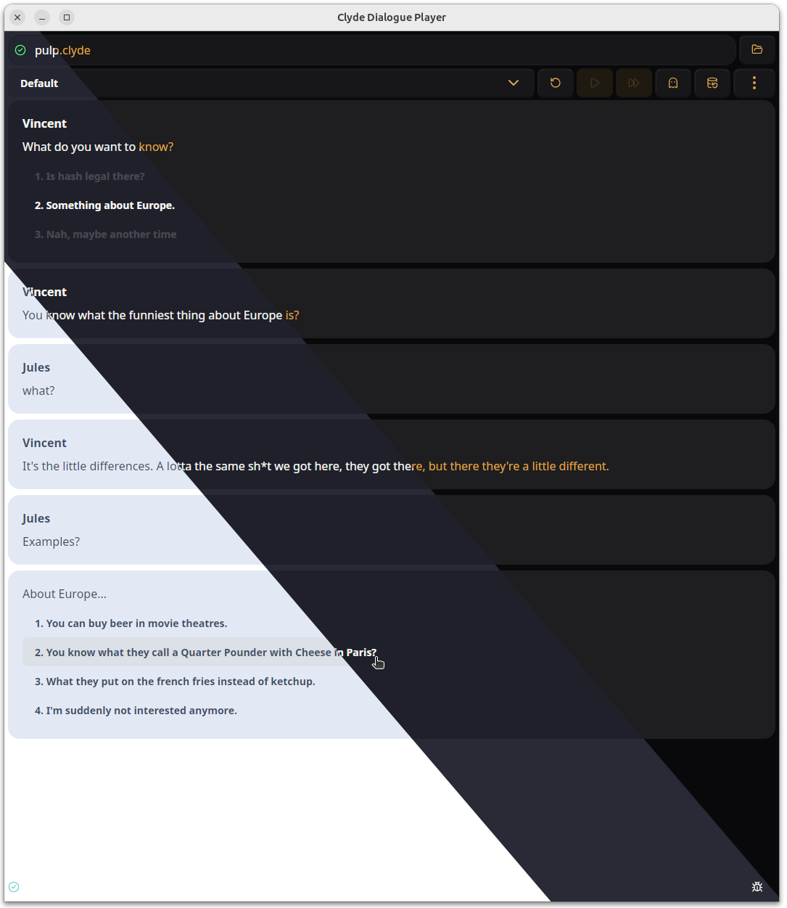

<!--
custom_page_class: standalone-player-page
-->
# Dialogue Player

> This player is still in beta. You can send feedback, suggestions, and report bugs in the [repository](https://github.com/viniciusgerevini/clyde-player) or reaching out to me on [Mastodon](https://mastodon.gamedev.place/@thisisvini) or [Bluesky](https://bsky.app/profile/thisisvini.com).

Execute and debug any Clyde dialogue file without an engine installed.

## Features

- Open, execute, test, and debug Clyde dialogue files with handy features, like "forward to option" and "Poltergeist mode".
- Watch for changes in the open file and notify and reload the dialogue if needed.
- Debugger for editing internal and external variables, and keeping track of changes during execution.
- It ships with 35 built-in themes thanks to Daisy UI.
- Pretty much the same feature set as Godot's in-editor [player](../3-godot/3-player-usage.md).

## Downloads

The app is built for Linux (AppImage, rpm, deb), MacOS (aarch64, x64) and Windows (exe, msi).

__You can download the latest version [here](https://github.com/viniciusgerevini/clyde-player/releases/latest)__.

## Future Plans

This app is somewhat feature complete, but still in its early life. It's already fully covered by tests and with automated releases, ensuring quality and transparency.

I implemented most of the features already present in the Godot plugin, so it can be used alongside the [language server](./1-language-server.md) in your editor of choice for a nice authoring experience.

The time investiment I'll put in this app will depend on the usage and user interest. There are a few features I intend to get included before moving from beta, here is some idea what's in my mind (I won't necessarily implement all of them):

- Open files via CLI
- Keyboard shortcuts
- A way to communicate with your external editor (DAP? Sockets?)
- Custom theme support
- Other view modes (raw clyde content, diagrams, etc)
- Proper app menus

For suggestions, comments, and bug reports, reach out using one of the options from the top of this page.
